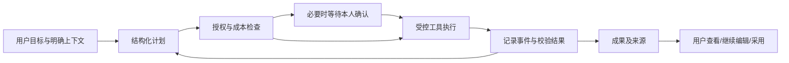
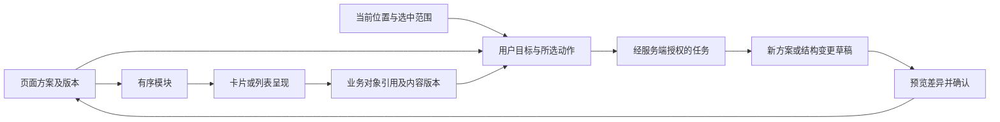

# 妙 / 讯 / 我与完整 Agent 的实现边界

更新：2026-10-20。本文说明已实现能力与后续提案；当前运行版本、迁移、设备安装及验收状态统一以[当前交接](handoffs/CURRENT.md)为准。接口见[统一 AI 交互体系](ai-interaction-system.md)。部署成功不代表完整产品链路已验收。

## 按需求组织协作（本地合同6工作区）

相册选材和建站是最早接通的两类执行器，不是协作的固定路径。管家发起的`coordinated`任务由模型根据共同目标和本任务实际授权的能力目录选择参与者，生成有依赖的分工；服务端验证能力、引用和无环依赖，Worker领取可执行节点，协调者依据真实交付继续规划或完成。独立子目标可以并行，无需多人时可只用一个Agent。专业会话发起的`direct`任务固定由当前专业Agent执行；普通咨询只回复，不为展示协作制造任务。

当前实现复用原工作空间、节点、回执和队列，已具备显式`contribute`模式与`text_result`成果；本轮新增专业会话分派和直接任务。专业正文自由使用自然段落、列表、分镜或脚本，不要求用户可见的固定JSON模板。内部成果类型用于验证和渲染，不是规定所有回答长成同一格式。注册声明必须匹配真实执行方法，普通聊天不能自动升级成执行能力。

| Agent | 可交付能力 | 明确边界 |
| --- | --- | --- |
| 相册管理 | 鉴权素材检索与选择 | 真实检索记录、当前同意与内容版本，不伪造照片 |
| 建站 | 结构页面草稿 | 完整预览后确认保存 |
| 文件预处理 | 明确上传的UTF-8文本与所选消息摘要 | 仅专业direct；不自动读取设备、PDF或整库文件 |
| 漫画日记 | 文字分镜 | 不生成最终漫画图片 |
| 视频制作 | 视频脚本与镜头说明 | 不渲染成片 |
| 形象顾问、3D形象顾问 | 文字形象建议 | 不修改资料或发起3D生成 |
| 妙管家 | 显式依赖成果的文字汇总 | 不把计划或回复冒充实际工具执行 |

文本可独立完成，也可成为另一个已授权专业节点的输入；不强制转为页面。文字交付直接成为任务成果，实际修改或发布继续使用对应确认流程。建站显式声明消费`text_result`、`media_selection`和原版`site_draft`，也可使用选中的消息、日记或照片；文字交接保留来源并重新鉴权，页面仍须完整预览后确认保存。

共享范围由任务与节点决定。节点只接收本轮目标、明确选中的引用及显式依赖，不读取其他Agent私聊、整个账户或全库。衍生文字在数据库中保留完整来源快照；下游按自己的授权与任务原快照重新校验全部来源，源节点有权限并不赋予接收者权限。协调规划仅接收引用类型、节点目标/状态及成果类型/来源类型，不接收资料正文、自由题名或专业成果正文；需要综合正文时创建显式汇总节点。管家模型只决定回复、澄清或所需能力，共同目标由服务器从明确需求链的用户原文构造，不把模型整理出的私有上下文提升为共享目标。撤权、资源变化或Agent声明变化会阻止后续交接与保存。

公开文字成果只含`kind/id/title`，正文由专用鉴权读取接口返回，不经列表、取消或重放自动传递。未确认协作页面由039绑定所属节点，完整预览读取复用相同来源验证；草稿列表仅有metadata。确认保存后解除任务来源关联，页面属于用户独立保存内容，撤回Agent不会删除这份页面。

沿用的算法是模型规划与确定性依赖调度：目标理解、能力选择、依赖校验、可执行节点领取、成果反馈与继续规划。现阶段不训练新的选人模型、不引入关键词路由或额外编排框架。后续独立部署Agent可替换受控调用适配器，仍需遵守同一权限、输入、回执和成果合同；当前不是已经部署了独立服务。

发布制品必须能追溯到同一受验证源码，App/API/两个Worker按合同配套；这不限制协作组合或产品演进。本地合同6要求迁移043，保留041轮次与038回执。旧合同新请求明确拒绝，042之后保留执行模式、来源和轮次并优先前向修复；当前运行和验证结果见交接入口。

## 专业会话与任务统一（本地合同6，迁移042）

相册、建站、文件、漫画、视频、形象和3D顾问会话先由自己的`dispatch`判定回复、澄清或执行。模型仅能选择本专业真实已授权的能力，不得指定另一Agent、改写目标、追加权限或引用。咨询与澄清不创建工作空间；执行分派完成时，同事务保存任务及带`agentWorkspace.id`的回复，妙页和任务详情读取同一个持久工作空间。用户无需把专业需求再交给管家。

| 模式 | 发起与身份 | 执行及续作边界 |
| --- | --- | --- |
| `coordinated` | 管家分派或既有工作空间提交；需管家授权，`origin:null` | 管家规划实际已授权的专业节点，可交接成果；每轮必须产出依赖原版的新成果 |
| `direct` | 原专业会话的持久用户需求链；固定Agent、版本和一个能力 | 每轮一个专业节点，不调用管家协调、不依赖管家授权；只允许原能力消费真实基准成果，不能换Agent或扩大授权 |

042的`origin`严格记录`kind=agent_conversation`、`threadId`、`inputMessageId`、`agentId`、`agentVersion`、`capability`，来自服务端读取的本人会话和原用户消息。`input`保留有序需求消息ID及原文哈希；目标由真实用户原文组成，不使用模型生成的共享目标。模型派发、交付、任务私有成果读取及续作会重验当前账号、完整专业授权、固定声明版本、原消息链和引用内容版本。删除、撤回或修改来源会停止后续访问与执行，但不抹去已成功的执行历史或调用回执；已明确确认保存并解除任务绑定的页面仍是用户独立内容。

公开消息只提供`agentDispatch:{version:1,kind:reply|clarify|workspace}`、`agentClarification:{contextRefs,source:{currentPage}}`及任务入口。需求消息链、授权上限、请求指纹和分派内部状态不进入公开metadata。用户主动清除专业待续需求使用`agentContextReset:true`；它只重置待续需求，不改变资源权限，也不与管家重置或任务讨论混用。专业澄清按最新有效澄清消息续接，普通回复或任务回复结束该待续边界，不能从删除/撤回的末条消息跳回更早私有需求。

既有相册`ai_tasks`已接受键仍返回原任务，由原Worker完成，不能在重试时改建新工作空间。新相册执行使用`direct`工作空间和真实`media.select`成果，仍需云端同意、检索记录及素材版本验证。该能力尚不能接收`media_selection`依赖，所以直接相册成果不提供续作；协调任务仍可将素材交给真实支持接收的文字或建站节点。旧同步消息也仅按已保存回执重放，不重新分派。

本轮没有新增按会话过滤的任务接口或会话内进度轮询。聊天回复提供任务入口；进度、成果、取消和续作继续由现有妙页与任务详情承载。离线分派样例和隔离PG验证证明合同、事务及授权边界，不能证明真实模型选择质量、真机交互或已发布。精确接口与恢复语义见[统一AI交互](ai-interaction-system.md#专业会话直接任务本地合同6迁移042)。

## 已交付成果的连续修改

本地详情入口已实现同一workspace多轮：原始目标保留，每轮明确用户修改原文、基准成果和新产出，旧成果按原节点重新鉴权读取。完成不等于自动保存页面；每版草稿都有独立预览与当前审批。续作不重用澄清reply，不自动复跑失败/计费结果未知节点，不吸收后续新增权限。

服务端强制当前轮新成果且依赖原版；页面交接读取真实文档。历史页面来源校验与本轮保存基线分开，既允许保存后再改，也拒绝覆盖期间被其他操作更新的页面。永久续作回执和revision共同防并发重复开轮。准确API、DTO及恢复行为见[续作合同](ai-interaction-system.md#同一任务续作本地合同6迁移041)。

长按“带回妙管家”的本地实现保留用户熟悉的讨论入口，但消息额外绑定严格的 `workspaceContext` 选择器。后端从当前登录账号重新解析任务并校验revision/轮次、当前管家授权和会话；讨论模式只接收任务级元数据及同任务同轮短历史，不读取成果正文、原素材正文或专业Agent私聊，也不能调用工具、分派新任务或续作。普通发送只讨论；只有独立的“继续修改此任务”草稿，经详情页重新读取并明确核对后，才进入同一工作空间续作合同。主动移除关联后，下条普通发送会显式重置旧澄清和素材上下文。`direct`任务同样可绑定管家讨论，讨论单独要求管家授权；实际续作仍固定原专业Agent，不因此转为协调任务。真实模型质量、真机体验和生产配套须分别验收。

## 本次产品结构

参考用户提供的《妙-App-原型状态设计参考》及可分享 HTML，并按最新澄清纠正此前的目录理解：妙围绕一件事展示参与 Agent、用户目标和任务进展，分类表达任务所需的协作组合，类似围绕目标组织的群聊；它不是添加、移除 Agent 的管理页。添加管理继续位于“我”的既有小站入口，本轮不重排我页。讯仍为既有对话/任务页；顶部下拉二楼，保留空白落地、大内容区、底部横向六功能栏和上滑拖拽柄，不恢复常驻入口提示或返回大按钮。

| 区域 | 已实现结构（验收边界见下文） | 真实来源及边界 |
| --- | --- | --- |
| 妙 | 简约任务动态卡，按任务展示实际参与者、目标和状态；支持单列/双列浏览、真实任务/协作详情与需求草稿 | GET /api/tasks与GET /api/agent-workspaces；单任务只显示一个真实执行者，协作按持久节点汇总参与者，不用注册目录补头像或原型示例任务 |
| 讯 | 对话/真实任务分段、独立通知入口、新建、搜索、AI入口及聊天抽屉 | 原会话 API及GET /api/tasks；任务打开原会话或建站工作区，未提供假的总结未读/代回复 |
| 我 | 原小站的资料、生活、成果、生态、关系、Agent 添加管理和 3D 工作流 | 保留既有布局和授权链；本轮不做我页迁移；3D仍是独立专业流程 |
| 二楼入口 | 讯对话列表顶部下拉；静止时无提示占位；底栏隐藏；底部拖拽柄上滑返回，保留无障碍操作 | 手势只在列表起始位置且纵向拖动时接管，不影响会话横滑 |
| 相册 | 紧凑操作栏、三列真实相册封面、创建、选图上传、详情和编辑 | 复用内容组件与上传 API；只上传用户所选照片；不实现后台全库同步 |
| 文件 | 紧凑操作栏、图标/文件名/真实状态行、文本素材登记和详情 | file-assets API保存真实原文与文件信息并返回有限预览，不用关键词生成摘要/标签，不重复预处理；现已通过迁移043接入UTF-8文本上传、完整正文核对与专业摘要，PDF/DOCX仍未接入 |
| 关系 | 好友/关注/粉丝，打开主页及聊天，刷新失败提示 | 真实关系 API；没有关系质量/信誉的虚构分数 |
| 资产 | 妙点余额、真实流水及加载/重试状态 | 二楼局部面板读取现有余额/流水 API，不改小站；没有支付权限或依据有限流水推算累计赚取 |
| 信息海 | 应用通知概览、当前已加载通知及按需展开正文 | 展开不自动标记已读；未接入短信、邮箱、微信、系统通知读取或通话，不伪造 AI 整理结论 |
| 隐私 | 账号隐私说明与账号设置入口 | Agent授权仅在我页添加/移除；不重复管理权限 |

持久任务与独立AI Worker已随036部署，动态协作与独立节点已随037部署。页面不会自动触发模型、自动上传照片或自动授权。相册工具 `media-retrieval` 继续只作为相册管理的内部能力，不作为独立公开 Agent 卡片。

## 妙与二楼的当前实现

`features/miao/MiaoTaskFeed.tsx` 合并真实旧单Agent任务和`coordinated/direct`工作空间，卡片展示原目标、状态以及实际执行者或节点参与者。没有任务时显示真实空状态，不用注册目录或样例动态填满首页。普通咨询与澄清没有持久任务，不出现在该列表；专业执行分派成功后显示对应工作空间。两类查询默认分别最多30项，不声称已提供全历史分页。

`MiaoTaskWorkspace.tsx` 打开后用 `GET /api/tasks/:id` 及 events 接口读取当前任务和有限阶段事件，按 sequence 合并事件；列表快照不直接成为可执行依据。取消前重新读取最新 revision 和 allowedActions，执行中的任务不提供可靠取消的假承诺。待确认建站任务转到既有草稿预览后确认，详情页不会直接应用成果。退出页面、进入后台、切换账号或任务后，旧请求不能更新新页面；401/403/404清空已失效的详情。

`AgentWorkspaceScreen.tsx` 读取共同目标、各节点分工与成果，协作取消遵守 `cancelling`/`cancelled` 及执行租约边界。协作接口用 `inputRequest` 区分澄清与缺权：澄清可以回复；缺权引导我页确认授权后新建任务，既有任务快照不扩权。当前状态与历史节点记录已经分离，避免重复问询或取消后继续显示等待补充摘要。

当前实现以 `VoiceShortcutDock.tsx` 统一妙与讯的语音入口。两页保留三个方向按钮：妙为上方键盘、左侧妙管家、下方瀑布；讯为上方直接说、左侧总结未读、下方替我规划。妙/讯共享上左下三向按钮，轴向中心距约80pt、入口上移16pt；只有长按才展开菜单并开始语音，轻点不展开（已展开时可轻点关闭）。松手立即关闭交互并用140ms动画收起，系统开启“减少动态效果”时直接收起。按实际松手位置选择，原地或入口外松开取消；重复松手不会重新展开，迟到识别回调不会恢复菜单。读屏用户使用显式“开始语音输入”长按动作；语音错误或权限说明独立保留。妙长按时隐藏底栏，转写状态明确展示。

语音接真实系统识别服务，首次授权与录音分开，授权后须重新长按；权限、不可用、无结果等状态明确显示。iOS Simulator 明确不支持录音识别，真机识别及服务质量尚未验收。识别文本只是可编辑需求草稿，带入妙管家后仍需用户主动发送；不把语音识别当作已解析并执行的 Agent 计划，也不在识别失败后自动调用其他供应商。统一菜单及收起修复的设备验收状态见当前交接。

Agent 添加管理留在我页既有入口，确认仍提交用户实际看到的权限副本。首次添加相册Agent时把访问范围与云端AI说明合成一次确认，明确分析已上传素材、手机相册权限独立、移除可撤回并清理索引；已有有效云端同意复用，新增范围仍需确认。服务端与提交前重验均保留，不通过移动入口扩大授权或自动添加Agent；这也不取消任务执行或页面写入检查。

授权集中到“我 → AI伙伴”添加时一次确认完整范围，提交独立快照并重验会话/注册声明；二楼只保留账号隐私。不完整的历史授权明确要求移除后重新添加，不自动补权或保留另一套更新授权页面。外部启用API必须显式提交与当前声明集合一致的范围数组，部分范围拒绝；聊天、排队任务与专业能力目录在执行时也重验完整范围，禁用统一撤回为空范围。任务自身的最小范围快照继续约束执行，新增授权不能扩大旧任务。协作卡已接入 `AIContextActions` 长按，目标、id/revision、状态和真实参与者先作为可见选择快照；选中“带回妙管家”后，客户端另提交严格任务选择器，服务端按账号解析原任务，不能由可见文字授予权限。关联消息仍仅供讨论；实际续作要用户另行选择并确认。

首次进入的默认底栏为妙。需求草稿与聊天保留对象名称、必要的任务状态和参与者说明，隐藏“发起位置”“所在模块”、内部ID及revision等工程标签，不再把这些标签拼入用户消息。有效素材仍以结构化 `contextRefs` 发送，原始位置仍通过 `clientContext.currentPage` 传递并在重试时保留；隐藏文案不删除真实引用，也不替代服务端权限检查。任务讨论的账号、会话、轮次及消息幂等边界见[统一AI交互](ai-interaction-system.md)，实际设备验收状态见当前交接。

二楼默认保留大空白区域，选中工具后显示统一内容面板；再次点击工具可收起。面板以紧凑操作栏或概览块开始，去除重复大页头。文件/相册编辑跨工具保留，保存或上传期间工具切换、底柄上滑、读屏返回及Android返回暂不可用。文件详情、关系加载/失败/重试、余额和流水来自真实 API；相册使用鉴权封面。关系展示真实联系人数据，不用四块假评分占位；资产不据有限流水推算累计收支。工具栏按实际容器宽度完整显示五项，第六项横向滚动可达并按项目间距吸附，避免首屏截断标签；六项功能和既有小站数据布局保留。

固定 iPhone17 使用唯一正式妙讯入口直连既有生产服务，不另建开发 App/API。安装与验证边界见[当前交接](handoffs/CURRENT.md)与[启动说明](local-development-preview.md)。

## 统一需求入口与模型配置

妙与讯的通用新需求入口汇入妙管家，用户无需再选择“聊天”或“协作任务”；已经进入专业Agent会话的需求由该Agent直接分派。服务端`butler-dispatch.js`与`specialist-dispatch.js`均只接受回复、澄清、创建工作空间三种严格决策，执行能力来自真实注册声明与执行器的匹配目录。管家按目标选择已授权参与者，专业分派只能选择本Agent能力。相册`media.select`、建站`site.compose`与上表的专业文字执行器保留真实能力边界；缺权不用模型文案或前端开关替代校验。已有未确认的旧提交仅保留恢复同一请求的入口，不与新需求表单并存。

未关联原任务的普通新需求，在用户明确发送后可由管家分派创建任务；绑定原任务的发送只讨论。管家将新目标整理为工作空间时，以输入消息ID生成稳定提交键；创建工作空间和写入带`agentWorkspace.id`的回复同事务完成，重放同一消息不会重复建任务。任务详情继续读取服务端状态；保存页面仍先完整预览，再单独确认私有保存。分派期间新授予的能力不会加入本次请求，任务内的权限快照与撤权检查也不会因入口统一而省略。

本地管家和专业Agent新消息要求任务1与协作6声明，页面合同为2；协作草稿来源由迁移039约束，续作轮次由041约束，直接执行模式及来源由042约束。客户端按会话bootstrap判断，后端拒绝旧协作合同的新请求；历史已接受消息仅按原合同重放已保存结果。API、两个Worker和客户端须按同一合同配套，实际运行状态见当前交接。

澄清内部保存服务端写入的用户需求消息ID链、`contextRefs`内容版本和发起来源，公开DTO只保留引用与来源。短答复或中间普通回复可继续这份需求，客户端恢复引用时不覆盖用户正在编辑的草稿；服务端在模型调用及结果提交前重验原输入与素材。缺少原引用时继续澄清，不把选中相册变成全库检索。用户主动移除待续引用后显式发送`butlerContextReset:true`，后端按本轮新范围理解，重试保留该标记，不悄悄接回旧目标；删除、撤回或版本变化明确失败。实际设备上的澄清续接与完整业务链仍需验收。

模型调用按角色配置：显式`chat`、管家`discussWorkspace`和媒体检索原文解析使用`NEW_API_MODEL`；管家及专业Agent的`dispatch`、主管`coordinate`、文字`contribute`、结构化生成及带工具规划使用可选`NEW_API_PLANNING_MODEL`，未填写时按声明继承前者，共用地址和Key。新专业会话使用`dispatch`，不按回复看起来像聊天就另走`chat`。调用失败不会自动换模型或供应商。实际供应商、模型与真实调用证据统一见当前交接，代码中的推荐配置不替代运行环境。具体模型路由集中于`agent-model-config.js`，凭据留在部署配置，不进入Agent代码。视觉分析与图文向量当前仍使用独立DashScope原生合同，1024维同一图文空间不能只换URL或模型名代替适配；3D保持独立专业链，不在本次中转调整中改接。

## 完整 Agent 的定义

Agent 是对目标负责的、可恢复且受授权约束的执行单元。模型负责理解、选择下一步和产生结构化计划；服务端负责决定什么能执行、记录执行事实，并向用户交付可使用的成果。

必需组成：目标与验收条件、可验证的输入引用、受限计划/工具循环、范围明确的权限、持久化运行状态、外部副作用前的确认、可撤回的记忆、可追溯成果、失败/取消/恢复机制和费用审计。不能以“注册文件 + 一段系统提示词 + 一次聊天请求”代表这些都已交付。

## 现有代码能力

- `agents/registry.js`：文件注册、身份和权限声明校验；分类是展示维度，不是路由或授权规则。
- `backend/src/agent-runtime.js`：供应商适配与受控工具循环。管家和专业会话均使用`dispatch`，用户明确交办时创建真实工作空间，普通咨询只回复、需求不清才澄清。`agent-workspace-service.js`按`coordinated/direct`分别安排管家计划或固定专业节点，两者共用能力执行器与AI Worker。旧已接受相册任务仍由`ai-message-task-service.js`执行。仍不支持通用递归委派。
- `backend/src/routes/message-routes.js`：消息合同、幂等及授权适配；`specialist-message-service.js`持久受理专业消息并在模型前/完成前重验。分派同步返回答复、澄清或任务入口，工作空间创建与对应回复同事务提交，专业节点随后由Worker执行。旧相册已接受键继续返回原`ai_tasks`，不能因重试产生第二份任务。`ai-task-repository.js`保留旧单任务真实阶段事件，不能把同步答复当成已完成专业成果。
- 媒体检索已有持久任务、单调事件、内容指纹、epoch、预算和取消边界。但 `/api/agent-runs/:runId/events` 的当前实现限定媒体检索，不能直接作为全体 Agent 的事件 API。
- 相册卡片是可鉴权打开的图片/视频引用；建站是可应用的持久草稿；漫画、视频等交付成熟度不同，供应商配置就绪不等于最终作品生成已完成。
- 3D 已具备独立任务、费用确认、四视图确认、恢复与模型管理；其专业 UI 和执行链不应为了统一入口改造成聊天机器人。
- 管家的客户端主题/导航命令仍为既有有限匹配，不是通用计划执行器。本次没有扩充该匹配机制来模拟 Agent。

## 页面、模块、卡片与业务对象的数据组织

产品中的数据包括文字、图片、对象关系、任务过程，以及有结构的整张卡片、整个模块和整个页面。Agent 需要理解用户选中的范围、该范围如何组成、用户正在进行什么操作；界面还必须能根据同一份结构准确呈现结果。这里区分业务内容、页面编排与当前交互位置，避免将一个页面的所有内容复制成新的业务数据。

### 已部署的持久化基础及实际渲染范围

结构页面2已随正式协作升级部署并安装到固定iPhone17。6份旧页面、3份当前副本及15个链接/消息/关注动作已按用户选择无损迁移，恢复材料保留原文；运行时不提供旧格式兼容渲染。保留动作只是未接通的意图，不能点击执行。迁移事实见[正式升级](reviews/2026-10-12-production-agent-workspaces.md)。

| 层级 | 当前真实存储 | 当前边界 |
| --- | --- | --- |
| 页面方案 | 复用 `station_site_drafts.draft` JSONB；确认后保存到 `user_profiles.station_config.siteLayout/siteDraftId` | `schemaVersion:2`、稳定documentId、不可变revision=1、private范围；重新生成创建新文档，不代表妙、讯、二楼都已成为可编辑文档 |
| 页面模块结构 | 有序sections包含服务端分配的稳定id、类型、标题、副标题、正文、素材/日记ID和受控动作；最多8个模块，类型为 `hero/about/gallery/diary/contact` | 模块嵌在文档内；没有模块编辑或移动接口。素材/日记绑定当前资源，不保存另一份历史资源快照 |
| 页面渲染 | `SiteDocumentRenderer` 同时展示待确认与当前保存页面的完整文案、顺序、四种主题、素材及日记；文档接口精确读取全部绑定 | 页面仅本人在建站工作区查看；删除仅按section类型重排我页三个模块的旧路径，我页既有布局保留。没有通用页面编辑器或公开发布 |
| 卡片 | 妙单任务卡由 `ai_tasks` DTO 渲染，协作卡由工作空间/节点聚合渲染，相册/日记/消息卡由对应资源渲染 | 卡片一般是同一业务对象的一种视图，没有另存一份卡片正文；同一相册出现在二楼和我页仍是同一个相册 |
| 业务内容 | `chat_messages`、`station_albums`、`station_diary_entries`、`station_media_assets`、`file_assets` 等按现有业务表保存 | 已入库不表示所有种类都能供 AI 引用；当前引用支持消息、相册、日记、图片以及有完整正文的文件；各Agent仍受能力声明与授权限制 |
| 任务与成果 | `ai_tasks`/`ai_task_events`保留旧单任务与阶段事件；工作空间/节点保存共同目标、授权快照、依赖和逐调用回执，041保存轮次，042保存执行模式和专业来源 | 旧单任务成果为消息/建站草稿；工作空间成果为精确素材选择、文字或建站草稿。没有任意页面/模块/卡片成果类型，不能自行新增 kind |
| 当前 UI 位置 | 客户端路由、二楼所选工具、被长按的对象、当前查看的任务阶段 | 属于查看时的交互上下文，不是数据库中的页面对象，也不是读取整页内容或执行动作的授权 |

后端 bootstrap 的 `modules` 由 `buildAppModules` 根据能力和实际状态构造，是模块能力说明，并非持久化的页面节点树。建站草稿已具备账号归属、稳定节点、严格结构与完整预览；确认事务复核草稿、资料和引用资源hash，过期或内容变化会阻止应用。实现与早期验证见[结构页面证据](reviews/2026-10-12-structured-pages.md)，当前部署以上节为准。

### 统一关系及拟扩展合同

以下是更通用的演进合同，不是现行 API。已部署页面实现建站文档的扁平section结构、稳定身份、有限主题、查看动作和保留的未接通意图；任意节点树、字段选择及结构变更仍待实现。不为每个按钮、每张卡片建立一张表，也不把节点当新的资源所有者。

| 对象 | 需要表达的内容与约束 |
| --- | --- |
| 页面文档 | 稳定页面 ID、owner、schemaVersion、内容 revision、用途、标题、有限主题令牌、有序模块及来源 task/artifact；账户归属来自服务端认证 |
| 模块/卡片节点 | 文档内稳定 nodeId、父节点、已注册 componentType、有限展示属性、children 或数据绑定；节点顺序改变不应改变 ID；不使用数组下标作为长期引用身份 |
| 内容绑定 | 使用 `{kind, id, version}` 引用真实对象；动态列表采用注册的数据源及有限过滤条件，保留加载范围、分页与数据版本；不允许任意 SQL、任意 URL 抓取或客户端声明 owner |
| 所选范围 | 明确选择页面、模块、卡片还是字段，并记录 `documentId/revision/nodeId`；尚未持久化的页面只能带客户端位置及本次可见结构快照，必须标明范围和截取时间 |
| 动作 | 组件只声明注册的 actionKey 和目标引用；执行器核对当前 owner、可见性、Agent scopes、资源版本和任务状态；修改、发布等按既有确认流程执行，不把按钮存在视为授权 |
| 变更方案 | 明确目标文档、基准 revision、受影响节点及添加/移动/替换/删除等有限操作；生成后预览差异，确认前重验版本，冲突明确失败，不覆盖用户后续修改 |

渲染器只把白名单中的 componentType 映射到项目已有 RN 组件。例如页面由容器、标题、文字、相册网格、任务卡与成果引用组合；类型及其 props 必须有逐项 schema、节点数量/深度/文本长度上限。布局使用统一字号、间距、颜色和尺寸令牌，特殊流程仍使用已审查的专用组件。模型输出是结构化候选文档，不保存或执行任意 JavaScript、JSX、HTML、事件处理代码或动态组件路径。未知组件、动作或不合法引用需要明确拒绝或显示不支持，不映射为另一个会执行的动作。

已部署实现移除了 `normalizeSiteDraft` 的过滤和默认值路径。后端与RN共享 `shared/site-document.js` 的严格校验；模型只生成内容，服务端分配身份/版本/可见范围，未知字段、模块、主题、动作和非法引用明确失败。可执行动作仅查看同模块绑定的素材与日记；链接、消息、关注意图按结构保留但显示未接通，不执行任意URL、转账或外部发送。生成正文可能来自私有内容，因此访客与好友接口不返回siteLayout；公开发布仍需独立的范围与确认合同。

### 最小实施与迁移顺序

1. **当前客户端统一范围认知**：沿用同一长按入口表达所选对象和请求目标。将可用对象作为真实引用，用户可查看、移除后再发送；可见来源说明已简化，页面位置继续以结构化字段传递。当前 `clientContext.currentPage` 不授予权限；失败重试保留原始来源。长按整卡不等于只读卡片数字，也不等于自动读取所有隐藏字段或其他页面。
2. **一类页面的闭环已部署**：建站草稿及确认链使用严格schema、稳定页面/模块ID、精确资源读取和同源RN预览。数据加载完成且文档/资源hash与审批一致才允许确认；后端事务再次重验并保存当前私有页面。没有重排我页或新建数据库。仍须完成真实素材协作链的设备验收；独立查询、多人协作或部分修改确有需要后再决定是否拆表。
3. **再开放模块/页面级 AI 选择**：服务端按页面归属、节点范围和每个资源的当前权限解析选中内容，生成有版本的内容清单。当前消息引用上限6项，且相册引用只解析标题/描述、图片引用只解析元数据，并不自动读取整本相册或原图。不能把整页悄悄截成6项后声称“已分析整页”；超出能力时明确提示选择范围，待带分页、预算和引用授权的集合合同完成后再开放完整模块/页面处理。
4. **最后开放结构变更和任务成果复用**：Agent 产出有来源的卡片、模块或页面草稿；同一成果可在任务详情、二楼或个人页用相同组件呈现。新增成果/引用种类、版本检查及节点变更必须配套后端合同、测试和部署，再启用客户端能力。源对象删除或撤权后重新解析引用，不能依靠已保存的卡片快照继续访问。布局复用与内容共享不扩大可见范围。

可据此表达真实需求：“整理这个相册卡片”以相册引用和用户目标为输入；“调整这个模块”以模块所在文档、节点及内容引用为输入，产出差异草稿；“围绕当前任务生成一个工作页面”以经授权的任务、成果及参与者为输入，产出受限页面方案。后两项仍需上述通用合同与渲染工作，当前来源上下文和协作卡快照不等于能读取整页或原任务全部成果。已部署的038账本只处理提交结果，不提供这些通用页面能力；本文不授权部署。

## 完整平台合同提案（部分基础已实现）

继续沿用 RN + Node 模块化后端 + PostgreSQL，不引入新编排框架或微服务。036单Agent任务与037协作节点已实现下表的部分基础；当前精确DTO、支持动作和验证以[实际合同](ai-interaction-system.md)为准。以下更完整的步骤、预算和记忆字段仍是演进目标，不能当成当前接口。

| 对象 | 最小字段与规则 |
| --- | --- |
| AgentDefinition | key、version、能力、输入/结果 schema、允许工具、授权范围、运行预算；客户端不控制工具白名单 |
| Workspace | ownerId、用户目标、上下文边界、参与者、父任务及活动流；表达围绕一件事的协作空间，不能用聊天展示状态代替服务端记录 |
| Participant | workspaceId、agentId/version、职责、授权范围快照、加入/退出状态；权限是用户当前授权、工作空间范围和父任务范围的交集，执行时再次验证 |
| Task | id、ownerId、goal、agentId/version、contextRefs、status、revision、当前用户可见阶段、deadline、成本预留；在执行前持久化 |
| ContextRef | kind、资源 id、内容版本、选定范围；每次执行重验 owner/可见性/同意，不能将正文中 `kind:id` 当授权 |
| ToolCall | runId、stepId、工具及版本、经 schema 校验的参数、幂等键、所需 scopes、结果/错误；来自模型的请求只是候选操作 |
| Approval | id、操作类型、对象、参数摘要/hash、成本/限额、版本、过期时间、pending/approved/rejected/expired；参数变更或过期使旧确认失效 |
| RunEvent | runId、单调 seq、type、timestamp、有限展示 payload；不输出隐藏推理、密钥或原始供应商日志 |
| Artifact | id、kind、版本、来源 run/输入引用、权限、处理状态、可执行动作；动作在服务端重新鉴权 |
| Memory | 独立记录来源、用途、同意、有效期与删除状态；“记住”需显式可管理，不能自动把所有聊天永久保存为跨 Agent 记忆 |

现有 `ai_tasks` 仍为单 `agentId`；已部署工作空间及独立节点聚合（迁移037），没有独立Participant表或通用递归委派。管家根据目标提出协作计划，服务端校验能力、参与者职责、授权快照和无环依赖后落库，记录节点状态与逐调用回执。更通用的副作用工具仍需独立幂等键和成功/失败/结果未知回执；当前到期和撤权在执行前与执行中检查，通用成本预留仍是后续目标。工作空间不设固定累计步骤数、模型调用次数或规划轮次上限，保留实际用量和deadline。群聊式界面呈现执行事实，不赋予参与者权限。

现行协作状态包括 `queued/running/waiting_input/awaiting_confirmation/succeeded/failed/interrupted/cancelling/cancelled`；有运行节点时取消先进入 `cancelling`，Worker确认停止后才标 `cancelled`。明确区分请求中断与任务停止；已派发而结果未知的外部调用不自动重放。通用关联重试及任意副作用工具续跑仍是后续合同。

以下是更通用平台的候选接口形态，不是当前路由清单。现行单任务提交来自消息/建站接口，协作提交使用 `/api/agent-workspaces`；未提供任意Agent/工具执行入口：

- `POST /api/tasks`：目标、Agent、contextRefs、客户端幂等键；202返回已落库任务，不等待模型长调用。
- `GET /api/tasks?cursor=...` 与 `GET /api/tasks/:id`：仅当前用户可读的真实任务、恢复状态和支持动作；未知/越权对象使用一致404边界。
- `GET /api/tasks/:id/events?after=seq`：按序补偿、分页且可去重；实时通道只是加速通知，数据库事件是恢复依据。
- `POST /api/tasks/:id/approvals/:approvalId/decision`：revision、参数hash、决策和幂等键；并发确认、过期、撤权返回明确409/403，不执行原操作。
- `POST /api/tasks/:id/cancel`：幂等取消请求；返回服务端当前状态及哪些已发生副作用不能撤回。
- 成果 API 只返回可鉴权资源引用及允许动作。未知成果类型展示明确“不支持”，不解释或执行模型生成的任意 UI/代码。

运行合同版本随 schema 显式变化；源码、部署 API/Worker 和客户端分别验证。拆出的通用服务先接一条真实链路，旧专用路由在所有调用方迁移后删除，不保留静默新旧协议选择。

## 实施顺序与验收

1. **当前结构阶段**：妙按任务展示真实参与者与目标，任务详情和语音草稿入口；二楼使用紧凑工具面板。我保留既有 Agent 管理。妙管家承接新需求，增加对话分派、澄清原素材续接、相册单次确认与聊天/规划角色配置；此前默认妙、语音菜单、二楼工具栏等客户端增量一并保留。当前运行与验收状态见交接入口，连续手势和完整业务链仍待设备验收。RN负责展示，后端继续拥有授权和能力状态。
2. **任务基础已部署**：相册请求开始前持久化，真实事件、租约中断和重新打开恢复，RN通用任务卡与显式引用；单任务排队可取消，执行中可靠取消仍未开放，不能和协作节点取消混为一谈。
3. **成果与确认已部署**：建站共用任务组件，严格同源渲染器展示完整草稿与保存页面；草稿/主页/资源变化使确认失效。服务端按明确kind注册执行器，保留媒体、站点、3D各自查看器；已有页面和动作已保留迁移。
4. **动态协作合同6已实现**：主管动态计划、专业节点、素材交接、授权快照、deadline与真实回执已经运行；缺权/澄清分流、补充内容、统一授权操作、038提交结果及039协作草稿来源已有实现。定时任务、可管理记忆、递归委派及外部发送继续分别设计撤回与审计。
5. **本地连续任务合同6**：041同任务轮次、显式续作和原任务讨论保留；042将专业会话执行纳入固定专业Agent的直接工作空间，共用真实成果、审批和回执，旧相册任务按原键保留。当前是本地实现与隔离验证，未由此证明真模型质量或发布完成。
6. **质量阶段**：用用户授权的真实评测素材验证工具选择、成功标准、注入防护、失败恢复、耗时与费用；普通组件测试使用隔离测试夹具，不进入产品数据。付费评测与部署需本轮单独授权。

UI 当前统一的对象是“上下文引用 → 任务 → 待确认操作 → 成果”；不伪造百分比，不把多张 Agent 头像当成已发生的协作，不把提供建议和完成外部动作混写。原型中的未读总结、替我规划、沉浸工作台、后台自动任务动态，在对应真实任务合同落地后逐项接入。

## 多 Agent 协作演进记录（历史）

2026-10-12已完成动态协作实现、隔离联调与正式配套升级。管家选择实际注册且授权的专业能力，节点独立持久化并按无环依赖领取；主管根据真实成果继续规划、完成或向用户澄清。相册到建站是验收场景，不是固定执行顺序或关键词路由。完整真实素材专业链的设备验收仍待完成，不能由上线或纯文字验证推定通过。

Agent继续在独立agents目录维护；执行仍共用Node API、AI Worker和PostgreSQL。新增037工作空间/节点表，保留原单Agent任务及严格结构页面合同。精确素材成果绑定真实检索记录、当前同意与内容版本，建站只消费本次交接；取消、逐调用回执、实际用量计数和执行时限有实际实现，没有固定步骤数、模型调用次数或规划轮次限制。工作空间 `limits` 仅包含 `deadlineSeconds`，不返回次数上限或剩余次数；HTTP限流、单批schema长度和Worker并发限制继续独立生效。管理职责留我，协作共同目标与真实参与者展示于妙，二楼提供真实资源。

2026-10-13候选58a3b85完成协作合同2，随后c04385e加入图片预览门禁并完成正式配套。结构化 `inputRequest` 从主管已存决策生成。内容澄清可提交回复，缺权必须由用户确认授权后以新任务使用，不能改旧快照；用户补充内容通过037已有 `followups` 字段传给主管。038的 `agent_workspace_submissions` 记录owner/key/hash与accepted/rejected结果，旧成功提交一次性回填，明确拒绝经业务savepoint保存，5xx未知仍恢复原key。数据库、API、两个Worker和TestFlight46当时完成配套。后续统一入口复用这些表和工作空间合同，增加管家消息分派、待续引用/重置语义、任务回复绑定与外部授权范围校验；不是纯前端替换，也不按Agent或开发用途增加服务环境。

架构决策、官方来源和实现时测试见[协作闭环记录](reviews/2026-10-12-agent-collaboration.md)，037历史升级见[正式升级记录](reviews/2026-10-12-production-agent-workspaces.md)，历史038配套见[TestFlight46记录](reviews/2026-10-13-testflight-46.md)。当前运行与验收状态见[当前交接](handoffs/CURRENT.md)。合同回归不代表真实模型质量，编译不代表日常App已启用。通用递归委派、外部发送、定时任务和可管理长期记忆仍是后续范围。

## 当前验证边界

设计来源见[设计资料](app-design-assets.md)，当前检查与实际结果记录在 `docs/handoffs/CURRENT.md`。用户此前确认真机48账号同步恢复并可进入妙页；完整真实素材→多Agent交接→页面预览确认链、任务续作、连续下拉/上滑、方向选择和真机语音仍未据此验收。本地新交互的自动化回归也不能证明手感或真实模型质量；固定iPhone17须另核对布局与实际触摸。类型检查不能代替设备检查，模拟器不能代替真机或Android。当前没有完成全体Agent平台，也不把本次UI结构交付写成所有33个原型状态已经实现。

## 文件输入（本地合同6，迁移043）

已接入UTF-8 TXT/Markdown/JSON/CSV/TSV设备上传、完整正文和`station-file`版本引用。文件Agent的`file.summary`消费获准文件/消息并保留全部来源，`text.summarize`仍处理消息；分派只见文件元信息，正文仅交给专业持久任务。管家没有新增`files:read`，本阶段由二楼文件进入原专业会话的`direct`任务，不自动扩权或转交私聊。删除/变更来源或撤权后，历史保留但正文与续作不可用。格式、大小、上传幂等、正文核对、删除、迁移和保留边界详见[文件处理](file-processing.md)。PDF/DOCX、OCR、生图、成片和协作3D仍未接入；本地源码不代表生产或真机验收。
