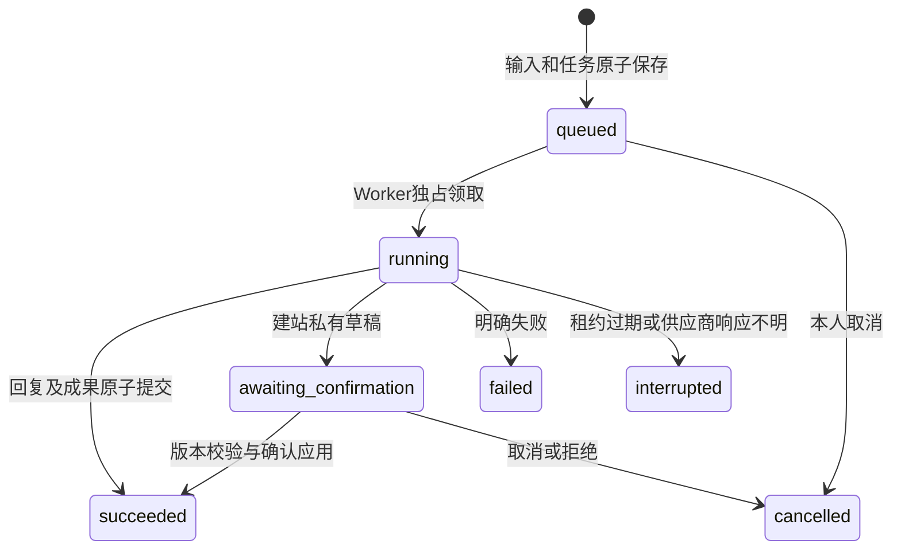

# 统一 AI 交互与持久任务

更新：2026-10-15。本文描述任务1、页面2、协作3的现行接口与权限边界；API、两个Worker、迁移和客户端的实际配套及验证状态统一见[当前交接](handoffs/CURRENT.md)。迁移039约束未确认协作草稿来源，运行仍共用同一API、两个Worker和数据库。本文不构成新的生产操作授权。

## 产品行为

统一的交互对象是**用户目标 → 上下文引用 → 任务状态 → 待确认操作 → 成果**。RN 的 `features/ai/AIInteraction.tsx` 提供引用、任务状态、确认和成果四类组件，`useAITasks.ts` 负责恢复与轮询。页面保持妙/讯/我及讯下拉二楼结构；专业媒体查看器和3D工作流继续独立。

### 页面中的 AI 上下文

统一入口还记录“从哪里、针对什么、准备做什么”：`AIAssistScene` 描述逻辑页面与模块，`AIAssistObjectReference` 标识所选卡片对应的真实对象；任务卡附带选择时的任务阶段快照。这里的“位置”是产品内页面/模块位置，不自动获取物理定位、整屏截图或其他未选内容。

- 妙单Agent任务卡、协作卡与相册卡复用全局长按菜单。相册在“我”和二楼统一使用`AlbumContextActions`，提供查看、妙管家、编辑与更多（分享/复制文字）；移除固定“理解/规划”双入口。选择妙管家打开统一`AIRequestComposer`，选中对象与必要快照可见、内容可移除；用户自行填写目标后带入管家，仍需主动发送。协作卡保留真实节点参与者、目标、id/revision及状态，打开菜单后的轮询不会改写已选快照；展示时隐藏工程标签，但保留结构来源和真实引用。
- `clientContext.currentPage`保留真正发起页面，不再统一误写成管家页。不会把“发起位置/所在模块”、内部ID和revision拼入用户正文；所选内容与必要任务快照仍可见，结构来源保存在消息metadata并用于失败重试、澄清续接与任务提交。位置与快照是上下文提示，不是服务端权限或实时任务状态。
- 相册继续使用合法 `station-album` 引用；任务只有在存在真实 `inputMessageId` 时附原输入的 `chat-message` 引用，不能把任务ID冒充新引用类型。没有原输入的任务仅提供明确的选择时快照；文件/通知等不新增假AI处理入口。
- 协作卡使用独立 `agent-workspace` 客户端对象，快照随可见正文与来源发送，不附带假的消息/素材引用，不支持服务端读取最新工作区或全部原素材。当前选中协作卡不能直接当作新协作的资源输入；需要正式工作区引用时另行补所有权、范围与版本合同。
- 草稿和选中内容按账号/token隔离；页面/会话/二楼工具切换使旧菜单失效。失败重试保留原来源、引用与幂等键。澄清待续需求保留服务端确认的原引用版本与来源，普通已完成消息不沿用旧上下文；主动移除待续引用发送显式重置标记，详见下文。
- 所有消息统一使用会话发送链；已删除本地关键词动作解析器及`localActionResult`合同，旧字段明确拒绝。“英文/深色/设置/建站”等词不再触发本地导航、偏好修改或预先报告执行成功。
- 完整需求含可见上下文遵守现行消息2000字符上限；超限明确阻止带入，不截断引用或隐藏删减。资源正文继续由服务器鉴权读取；有持久引用时不使用客户端metadata假冒资源正文。

共享视觉由 `shared/workspaceUi.tsx`、`shared/workspacePalette.ts` 提供，单任务/协作文案分别由 `taskPresentation.ts`、`workspacePresentation.ts` 提供。整页/模块/卡片的可识别结构与演进见[结构数据方案](agent-workspace-architecture.md#页面模块卡片与业务对象的数据组织)。已部署结构页面2复用建站JSONB，提供严格页面/节点schema、本人文档读取接口和共享RN渲染器；页面本身没有新增表。保存页面仅本人查看，不改变我页整体布局，详见[结构页面证据](reviews/2026-10-12-structured-pages.md)及[正式升级](reviews/2026-10-12-production-agent-workspaces.md)。

已部署的妙是围绕任务的简约动态：呈现目标、进展与真实参与者，打开单任务详情或协作空间。Agent管理保留在“我”，讯/我页不重排。单任务合同仍只有一个 `agentId`；037工作空间按实际节点展示多Agent及其分工，见[协作闭环](reviews/2026-10-12-agent-collaboration.md)。二楼使用真实相册、文件、关系、余额与通知，并提供账号隐私说明；通知展开不冒充AI处理结果。

- 相册管理：发送消息后立即返回已保存的消息和排队任务；Worker执行既有受控相册工具与模型循环，完成消息与任务在同一事务提交。离开会话或断线不会丢失服务端任务，再次打开从任务列表和消息接口恢复。
- 建站：保留专业需求输入，新需求也可由同一妙管家对话分派，已有专业建站工作区继续承担预览和保存。生成仅保存私有草稿；同一渲染器完整呈现文案、主题、顺序、素材和日记，文档/资源hash匹配审批后才能确认保存为当前页面。保存绑定草稿、主页和资源版本；重复确认不会再次写入。当前及历史schemaVersion=2文档可从工作区查看；已有6份页面/3份当前副本/15动作已保留迁移，无运行时旧格式兜底。链接、消息、关注意图保留但不可执行，没有公开发布或替换我页布局。
- 引用：聊天消息、相册、日记和已上传素材使用 `kind/id/version/title`，输入区可移除。标题由服务端解析，客户端正文、标题和 `kind:id` 字符串均不授予权限。图片引用当前只传资源元信息；不会把引用当作已看过原图。
- 失败：无配置、权限撤回、引用变化和执行中断都有明确状态。页面不展示虚构进度，不把素材未命中等同于调用失败，不自动重复不确定的付费调用。
- 单Agent任务取消：只允许取消排队或待确认任务；执行中的外部调用尚不支持可靠取消，服务端不会返回取消按钮或把HTTP中断标记为取消。协作工作空间有独立取消合同，运行节点先进入停止流程，不能将两类语义混用。
- 妙任务详情：进入时读取当前任务及 events，按 sequence 合并有限阶段记录；不以列表快照显示可执行决定。取消前再次读取最新 revision/allowedActions，状态变化明确报错。确认操作带用户进入既有建站预览，不从任务动态直接应用。按账号和任务隔离状态，后台停止轮询，权限或对象失效时清除详情。
- 妙语音入口：长按展示原型式语音区和键盘/妙管家/瀑布选择，原地松开取消，滑向入口再松开；转写进入可编辑草稿，带入妙管家后仍由用户主动发送。接入真实系统语音识别服务，权限与不可用错误显式展示；iOS Simulator 明确不支持识别，真机服务质量尚未验收。语音不会直接执行目标，也不会在失败时静默转向付费模型。
- 首次语音权限：缺少权限时识别返回 `speech_permission_required`，用户点击开启权限后单独调用 `prepare`；该操作只申请权限，不打开麦克风。授权成功后提示重新长按。拒绝后可进入系统设置；结束、离页和迟到回调均按会话标识隔离。讯原点击听写入口仍按准备权限后识别的既有语义执行。

管家声明可读取站点/相册引用；按用户明确决定，注册、显式管理员初始化与迁移040补齐默认管家的完整声明授权。其他Agent已有账号授权不自动扩大，缺少范围明确拒绝。Agent授权集中到“我 → AI伙伴”：添加前一次展示该Agent完整范围，确认后原子添加与授权，取消不写入；移除撤销范围，范围不完整时明确要求移除后重新添加。二楼只保留账号隐私入口，不再管理Agent授权。首次添加相册Agent的范围与云端分析说明合成一次确认：明确处理已上传素材、手机相册权限独立、可撤回且保留原件；有效同意复用。提交前、工具执行、素材交接和写入时继续校验，授权一次不等于永久跳过任务检查。外部启用API必须显式传`grantedScopes`数组，省略/非数组返回400；禁用统一空范围，内部账号初始化保留，详见[Agent接入](agents.md)。

## 单一管家入口、澄清与模型角色

妙与讯的新目标统一带入妙管家。普通咨询返回自然语言答复；明确交办且属于真实能力目录时，服务端接受严格`workspace`决策并创建工作空间；必要信息缺失时返回`clarify`。用户不再先选聊天或协作模式，也没有固定“相册后必须建站”的顺序。现有执行器包括`media.select`、`site.compose`及文字摘要、分镜、脚本、顾问与显式汇总的`text_result`交付，根据目标选择单Agent或多Agent。模型接入不等于生图、成片或任意工具执行；3D生成仍走独立专业工作流。

分派目录由后端注册声明、执行器合同和当前授权共同生成；缺权能力只用于展示授权待办，不成为可执行范围。用户明确发送后，工作空间以`butler-message:<输入消息ID>`作为稳定提交键，并与带工作空间ID的回复在同一数据库事务提交。重复消息重放同一结果；分派期间新增权限不加入本次请求的能力上限。旧客户端留存的未知提交仍恢复原key，新需求不再另填第二份协作表单。

`butlerClarification`在数据库保存服务端写入的完整用户需求消息ID链、原`contextRefs`及其内容版本、原`source.currentPage`；公开DTO只包含引用与来源。共同目标按链中真实用户原文构造，模型`workspace`决策只选择能力，不生成可共享的目标正文。短回答、待续期间普通回复和失败重试保留这份明确上下文；客户端重开会话可恢复引用，但不覆盖已编辑草稿。服务端在模型调用和提交前核对原输入未删除/撤回，重新鉴权并验证原素材版本。漏带原引用时仍要求保留或重新选择，不将原相册需求扩大为全库检索。主动移除待续引用则发送`butlerContextReset:true`，只按本轮剩余范围理解并保留重试语义；该标记只允许管家会话使用，不靠“重新开始”等关键词推断。

运行时按角色选择模型：专业Agent显式`chat`及媒体检索原文解析使用`NEW_API_MODEL`；`plan`、管家`dispatch`（含答复/澄清判定）、主管`coordinate`与文字`contribute`使用可选`NEW_API_PLANNING_MODEL`。不再按有无chat方法猜测plan用途；普通会话缺少chat方法时明确拒绝，不调用生成plan。未配置规划模型时显式继承聊天模型，共用`NEW_API_BASE_URL/KEY`，并非故障时自动切换；管理后台连通性测试可指定`chat`或`planning`，真实调用须另有授权。

实际供应商、模型角色配置与真实调用证据统一见[当前交接](handoffs/CURRENT.md)，不由代码中的推荐值推断生产已启用。视觉分析与图文向量仍是独立DashScope原生协议，向量要求同一图文空间的1024维，待协议资料到位再适配；它们不会自动继承聊天地址/Key，3D也不随本轮统一入口或规划角色配置改接。

文字成果公开引用为`{kind:"text_result",id:<产出节点ID>,title}`，列表、详情、决定和提交重放不包含正文。正文仅从`GET /api/agent-workspaces/:workspaceId/text/:nodeId`读取，返回`{id,title,content}`，重新校验产出Agent、接收链和所有原始来源；换号、后台、关闭及权限失效清除客户端正文，刷新/重试重新鉴权。正文自由排版，不自动执行模型URL、HTML或代码。页面仍使用原完整预览确认流程。

<a id="已部署任务合同1与页面能力2"></a>

## 任务1、页面2与协作3合同

所有接口要求登录，任务按当前账号鉴权。未知与跨账号ID均返回404。没有新旧协议自动切换。

`GET /api/app/bootstrap` 的 `data.contracts.aiTasks` 声明当前 AI 合同版本 `1`。RN 仅在当前会话接受的 bootstrap 中记录合同，不持久化、不按 Build 推测，也不通过写请求探测；缺失或非 `1` 时仍可登录和查看既有资料，但 Agent 消息、内容引用、任务查询/决定和建站提交会先明确报服务器不兼容，不发送对应请求。切换或清除登录态会清除合同记录，迟到的旧会话 bootstrap 不得覆盖新账号。协议由会话bootstrap与服务端校验，不能只根据Build号推测。

请求声明`X-Miaoxun-AI-Contract:1`。相册消息提交及重放、非空`contextRefs`消息、主页生成和任务接口在业务写入或模型执行前检查它，缺失或不支持返回426与`AI_CLIENT_UPDATE_REQUIRED`。协作接口另要求`X-Miaoxun-Agent-Workspace:3`。管家新消息因可能创建工作空间，必须同时声明任务1与协作3；协作声明不足返回426与`WORKSPACE_CLIENT_UPDATE_REQUIRED`，不能仅因为文本没有引用就绕过。这里是两个独立合同，不是把AI任务升级到2。好友与其他同步Agent既有边界保留。退役`POST /api/station/site-drafts/:id/apply`仍只返回明确升级错误，不读取或应用草稿。合同只说明客户端解析能力，不能替代账号、Agent授权和审批校验。

协议边界：管家新消息缺少协作3声明时明确返回426，包括无引用的新消息；同key已接受的无引用消息仍重放原结果，不重新分派。客户端发送任务1/协作3并按bootstrap校验，API、两个Worker、迁移039和客户端必须配套；协作2的新请求明确返回426，不保留旧成果格式兼容。

正式bootstrap另声明 `contracts.siteDocuments:2`。建站提交、文档GET与任务confirm要求 `X-Miaoxun-Site-Document:2`，包括确认重放；缺少声明时服务端返回426 `SITE_DOCUMENT_CLIENT_UPDATE_REQUIRED`。客户端按当前会话能力阻止对不匹配服务器的生成/确认/文档请求，没有旧接口兜底。cancel/reject和相册任务不增加此要求。页面能力独立声明，不能仅由 `aiTasks:1` 推定。

无引用且无重置标记的消息指纹继续使用生产既有`[content, replyToMessageId或null]`；非空引用追加`kind/id/version`，`butlerContextReset:true`纳入语义指纹。因此历史消息可用原key重放，引用或重置语义变化返回409；不做双指纹试探或自动换key重发。已保存的管家任务回复重放原结果，不再次分派或建任务。

| 请求 | 输入 | 返回及边界 |
| --- | --- | --- |
| `POST /api/threads/:id/messages`（相册管理） | content、clientMessageId、可选replyToMessageId/contextRefs | 202 `{data:{messages:[用户消息],task}}`；重放200，相同key不同内容/引用409；task为公开任务DTO |
| 同一消息接口（妙管家） | 同上，可含`butlerContextReset`；任务1与协作3声明 | 同步返回答复/澄清或带`metadata.agentWorkspace.id`的任务回复；回复与工作空间同事务提交，专业节点异步执行 |
| 同一消息接口（其他Agent/好友） | 同上；好友不接受AI引用，也不接受管家重置标记 | 原同步消息结果；Agent引用也在模型调用前及结果提交事务内重验权限与版本 |
| `POST /api/station/site-drafts` | prompt、idempotencyKey | 202 `{data:{task}}`；重复原请求返回原任务，改参数409；`apply`字段拒绝 |
| `GET /api/tasks` | 可选threadId、kind，limit 1–50，默认30 | `{data:Task[]}`；活跃任务优先，剩余为最近历史；目前无全历史分页 |
| `GET /api/tasks/:id` | — | 当前任务；私有执行输入、claim token、供应商原始日志不返回 |
| `GET /api/tasks/:id/events` | afterSequence>=0、limit 1–100 | `{data:{task,events,nextSequence,hasMore}}`；单调sequence，有限status/phase/errorCode，不包含模型推理 |
| `POST /api/tasks/:id/decision` | revision、operation（cancel/confirm/reject）、确认时approvalId | 服务端当前Task；过期/变更409，撤权403；同一审批+revision精确重放 |
| `GET /api/station/site-drafts` | 原limit | 已保存草稿元信息；旧 `POST /:id/apply` 明确返回426且不应用 |
| `GET /api/station/site-drafts/:draftId/document` | 页面能力2声明 | `{data:{document,documentHash,resourcesHash,mediaAssets,diaryEntries}}`；本人精确资源集合，缺失/删除/不可用引用409，旧文档格式409 `SITE_DOCUMENT_UNSUPPORTED` |

Task包含：id、contractVersion=1、kind、agentId/version、goal、threadId/inputMessageId、status、revision、phase、contextRefs、artifacts、approval、error、createdAt/updatedAt、allowedActions。goal来自用户原始目标；相册消息撤回/删除后不从任务保留另一份目标正文。Artifact仅允许消息与建站草稿引用，不执行模型产生的UI或代码。

消息读取、bootstrap、sync、发送/重放、撤回和实时事件共用`publicMessage`出口。消息只含id、threadId、senderType/name、content、metadata、clientMessageId、删除/撤回/创建时间；不返回owner、模型供应商、token用量、请求指纹、内部任务/检索运行关联。metadata仅保留好友senderUserId、回复引用、所选资源、重试来源/重置、管家澄清快照、工作空间入口和相册命中标记。管家快照的原输入ID只留在数据库，客户端按有效服务端快照恢复非临时消息，不另加持久来源标记。公开任务DTO的inputMessageId和message artifact继续用于真实输入引用与成果导航，两种合同不混用。

Approval绑定id、draftId、draftHash、profileHash、resourcesHash和30分钟有效期。确认事务锁任务、账号、授权、主页、草稿及被引用素材，重验后才应用，并同时完成任务和事件。前端按钮不是权限或审批依据。同一个资源解析器计算预览与审批hash，包含素材内容版本及元数据更新时间、日记更新时间；保留数据库时间精度。文档内容不可变，资源仍绑定当前内容，重新打开不会重建历史资源版本。

## 存储、运行与恢复

迁移 `036_ai_tasks.sql` 新增 `ai_tasks` 和 `ai_task_events`。任务行兼作PostgreSQL队列，包含owner、输入引用、幂等指纹、revision、claim token及租约；不把媒体专用事件API改成宽松通用JSON。



- `backend/src/ai-task-worker.js` 是独立进程，`npm run worker:ai-tasks` 启动；与API、媒体Worker使用同一版代码和数据库。单Agent任务路径一次执行一项，协作路径按依赖最多并行两个节点，使用SKIP LOCKED与租约协调；不按Agent另起服务，不阻塞独立媒体索引/清理Worker。
- 每个claim租约5分钟，每30秒续约；阶段推进和最终提交必须持有有效token。首个模型派发使用阶段CAS，重复执行同一claim不能再次发起模型。相册根据实际工具成果结束循环，不固定模型轮数或工具总次数；每轮派发前重新检查任务状态和当前授权，请求超时仍明确失败。
- 进程退出后尚未领取的任务可继续执行；已领取且租约过期的任务进入interrupted，**不会自动重放**。外部供应商是否已收费可能未知；此阶段不声称可以断点续跑任意工具步骤。
- RN每3秒读取当前页任务；离开页面、进入后台或切换账号后停止旧轮询，revision和会话作用域阻止迟到响应覆盖新状态。完整成果重新从原业务API获取；网络失败显示错误并可刷新。
- 建站提交键在请求前写入当前账号Keychain；响应丢失时可恢复同一请求。消息沿用clientMessageId；服务端接受后回来的消息会移除对应失败本地消息。没有把网络失败当作后端未执行。
- 任务与事件随账号级联删除，消息任务也随输入/线程硬删除清理。当前没有自动按天清理任务历史的作业；后续增加保留策略需同时保留幂等墓碑，避免旧请求再次执行。

## 隔离测试启动与验证

日常固定iPhone17连接正式HTTPS，不常驻另一套开发API/数据库/Worker。以下仅用于明确授权的隔离后端测试：在专属临时库迁移后启动测试API、AI任务Worker及需要的媒体Worker，使用现有 `DATABASE_URL`/`POSTGRES_*`、`NEW_API_*` 和检索配置，无新的供应商凭据类型；测试结束清理临时数据与进程。

```sh
cd backend
npm run db:migrate
npm start
# 另一终端，同一环境：
npm run worker:ai-tasks
```

本轮测试使用隔离PostgreSQL18/pgvector及测试进程内供应商替身，只验证协议/状态/权限，不代表真实模型质量。可复跑：

- `npm run test:ai-tasks`：普通单测，PG部分默认显式跳过。
- `RUN_AI_TASK_REPOSITORY_INTEGRATION=1 AI_TASK_REPOSITORY_DATABASE_URL=... node --test test/ai-task-repository.integration.test.js`：目标必须是空、loopback、`_migration_test`后缀的临时库，自行迁移。
- `RUN_AI_SITE_TASK_INTEGRATION=1 AI_SITE_TASK_DATABASE_URL=... node --test test/ai-site-task.integration.test.js`：同样使用独立空临时库。
- `RUN_AI_TASK_INTEGRATION=1 DATABASE_URL=... node --test --test-concurrency=1 test/ai-task-integration.test.js test/ai-message-recall.test.js`：使用已迁移的专属临时库，勿与其他执行队列测试并行共库。
- `./scripts/check-repository.sh`及Simulator原生验收记录见[当前交接](handoffs/CURRENT.md)。

## 发布条件与回滚边界

当前运行与恢复证据见[当前交接](handoffs/CURRENT.md)。[TestFlight46记录](reviews/2026-10-13-testflight-46.md)、036/037及旧页面迁移记录只保留为历史证据，不能据此判断当前配套状态。

合同1/2/3与迁移039包含管家新消息协作3门禁、需求原文链、分派与澄清metadata、显式重置、完整授权检查、文字成果鉴权读取及未确认协作草稿来源。后续变更须核验消息重放、待续引用版本、任务状态、未确认提交及客户端合同头，不能只换客户端。历史记录不授权新的生产部署、Git推送、供应商调用或TestFlight上传。

在获准发布时先备份和验证恢复点；有新迁移才执行受审查迁移，然后部署同版API/两个Worker与匹配客户端。systemd模板为 `deploy/marvels-chat-ai-task-worker.service.example`，Compose使用相同入口。Worker不提供HTTP健康端点，Compose显式禁用继承的API healthcheck。API ready只证明数据库迁移与API就绪，**不能证明Worker存活**；还必须检查进程、实际领取/心跳、错误日志、排队时间及interrupted数量。

回退旧API前需停止接收新任务、停止Worker并核对queued/running/waiting_input/awaiting_confirmation及未确认客户端提交，保存待处理事实。旧版本不理解当前协作决策、038提交拒绝账本或039草稿来源约束，不能直接重新开放写入。保留任务、节点及提交结果记录，优先同合同前向修复；恢复旧客户端/数据库需单独评估期间写入，不能覆盖恢复点之后的数据。

历史03回退案例：不能直接把03重新接到公网写入口，它会重新开放旧草稿应用，可能应用新版任务尚未确认的草稿；已缓存新版 bootstrap 的客户端也可能向03提交主页请求，导致同步生成后才因响应格式不符报错。确需退回03时，入口维护拒绝必须持续覆盖受影响写路由，直至新版任务与客户端状态核对完毕；仅要求客户端重新登录不足以保证该边界。上述合同门禁不构成部署或付费调用授权。

## 完整 Agent 仍待推进

普通Agent对话仍同步执行。尚未完成任意工具续跑、通用费用核账、长期记忆及撤回管理、定时任务、外部发送确认、流式输出、未读总结/回复规划与所有33个Demo状态。已有单Agent任务和下述协作工作空间分别有明确执行合同；不能把协作节点的取消能力当成所有旧任务都支持执行中取消。

后续应继续完善版本化工具schema、独立步骤幂等键及副作用回执、成本核账与评测，再接可管理记忆。费用和用量记录不等于给产品设固定调用配额；本轮用户明确要求不保留测试调用上限。

面向妙的群聊式协作目标，正式已有工作空间、职责节点、Agent版本、授权快照和成果交接。各参与者只获得用户授权与工作空间快照的交集，委派不能扩大权限。任意新副作用工具仍须实现独立幂等键、回执、撤权与结果未知状态，不能仅注册名称或提示词就开放执行。

<a id="动态协作已部署范围与合同2候选"></a>

## 动态协作现行范围

已部署037保存共同目标/独立节点，主管动态提出严格计划、完成或问询，专业节点按实际依赖分别领取，复用同一AI Worker进程最多并行2个节点。相册交付精确且有版本的真实素材，建站仅消费所选/交付资料。逐调用回执、当前授权、执行时限、幂等、取消与结果未知均有实现；不设固定累计步骤、模型调用次数或协调轮数上限。回执区分配置model与供应商实际servedModel，未报告的字段为null。当前专业能力包括素材选择、页面草稿和显式文字贡献，完整能力与限制见[工作空间方案](agent-workspace-architecture.md#按需求组织协作合同3工作区)；不执行通用递归委派。初版API/数据库合同见[协作实现记录](reviews/2026-10-12-agent-collaboration.md)。

协作合同3使用`/api/agent-workspaces`的创建、列表、详情、素材与decision路径，输入请求DTO和主管决策如下：

- `inputRequest: {kind: 'clarification', question}` 表示内容澄清，只有此类 `waiting_input` 可执行 `reply`；用户回复保存在037已有 `followups` 并传入主管规划上下文。
- `inputRequest.kind: 'agent_access'` 带实际能力目录生成的Agent/能力/必要scopes、缺权原因和 `nextAction`。主管只选择目录中的能力标识；服务端验证并生成授权要求，不读取模型文案推测缺权。
- `authorization_required` 引导到我页确认范围后新建任务；`new_task_required` 表示当前已有权限但旧任务快照不含该能力，需新建任务。两者均不允许通过 `reply` 扩大旧快照；新任务必须经用户主动提交。
- 客户端分开展示当前输入请求与历史节点记录，取消/中断等终态不继续显示旧待办摘要。Agent授权集中在我页添加时确认，二楼只保留账号隐私；不完整的旧授权需移除后重新添加，不自动扩大任务快照。
- 已部署038增加 `agent_workspace_submissions`，按owner/key/hash持久化accepted/rejected结果并一次性回填037成功提交。业务savepoint中的明确拒绝成为可恢复的终局；未知结果保留原key，不因HTTP 4xx就清key重发。5xx/网络失败继续核对同一提交，避免并发重复创建或永久卡住可修正的草稿。

对话统一入口复用上述权限、节点、提交结果及成果合同，合同3的文字成果与039草稿来源约束也使用同一执行器体系；运行时不解析旧自由文本生成授权动作，不设旧协作合同回退。完整真实素材设备链、任务续作和连续手势仍待设备验收；已有真实模型样本不证明任意需求质量。通用记忆与完整费用核账仍待实现。
