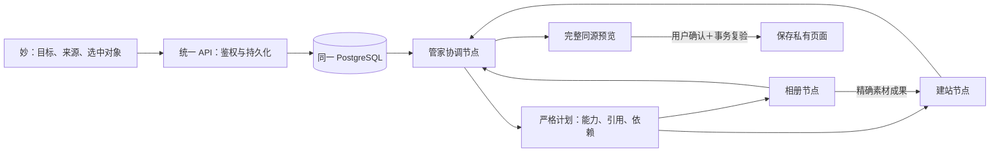

# 多 Agent 协作闭环候选

本轮已完成本地候选实现与隔离前后端联调。生产仍是 `ai-tasks-20261012-01` / 迁移036 / TestFlight45，没有部署、上传、推送或调用付费模型。候选保持同一个App、API、数据库和AI Worker；配套升级前不覆盖日常iPhone17 App。

## 架构决策

Agent作为 `agents/` 中的独立版本化能力模块维护，由现有Node运行时执行。采用主管协调方式：管家负责共同目标与最终成果，专业Agent只执行明确子目标并交付有类型、有来源的结果。新增独立Agent需要声明输入、依赖成果、输出、权限并实现受检执行器；仅注册一个名称或提示词不会获得可执行权限。

官方资料已实际阅读：[Codex子Agent](https://learn.chatgpt.com/docs/agent-configuration/subagents?surface=app)、[Agent编排](https://developers.openai.com/api/docs/guides/agents/orchestration)、[SDK与托管服务](https://developers.openai.com/api/docs/guides/agents/sdk)、[模型配置](https://developers.openai.com/api/docs/guides/agents/models)。子Agent的职责隔离、独立工作并行、结果摘要和共享写冲突控制适用于此项目；具体实现采用agents-as-tools式主管模式，主管始终负责共同结果，没有转移App账户权限。

本轮扩展现有供应商适配运行时，未引入另一套SDK或更换模型供应商。SDK也可内嵌应用，而不是要求每个Agent单独部署；现有模型传输不能直接视为支持所有Responses/托管Agent特性。以后若实际需求需要SDK特性，应明确迁移原运行时及合同，避免维护两套模型路径。

图中相册到建站是首条验收场景。执行顺序由模型依据真实能力目录和当前成果动态提出；可以直接使用一个专业Agent、并行处理独立目标、继续追加节点或向用户澄清。没有关键词路由、固定管线、隐藏会话或旧接口兼容兜底。

## 实际合同

- 迁移037增加 `agent_workspaces` 与 `agent_workspace_nodes`。共同目标、页面/模块来源、最多6项精确引用、权限快照、Agent版本、节点职责/依赖、私有成果与调用回执均持久化。页面正文仍复用既有JSONB和结构文档合同，不为每张卡建立一张表。
- 新合同 `agentWorkspaces:1`，所有协作API同时要求 `X-Miaoxun-AI-Contract:1` 与 `X-Miaoxun-Agent-Workspace:1`；确认保存另要求 `X-Miaoxun-Site-Document:2`。bootstrap声明实际支持，旧服务或旧客户端明确报不支持，不调用其他路径。
- `GET/POST /api/agent-workspaces`、`GET /api/agent-workspaces/:workspaceId`、`POST /api/agent-workspaces/:workspaceId/decision`；decision为 `cancel/confirm/reject/reply`，要求当前revision，确认绑定approvalId，回复限制2000字符。共同目标也限制2000字符，超出明确拒绝，不截断。
- `GET /api/agent-workspaces/:workspaceId/media/:assetId` 只读取本人成功节点实际交付且版本/检索同意仍有效的素材；不从bootstrap库猜测成果，当前相册Agent授权撤回后拒绝读取。
- 专业执行器目前为 `album-manager/media.select → media_selection` 和 `site-builder/site.compose → site_draft`。当前候选管家0.2.2，相册/建站0.3.0；建站协作显式要求 `album:read` 加原建站三项权限。旧授权不自动扩大，缺失时能力目录排除；用户在“我”中明确重新授权后才能参与新任务。
- 服务端限制能力、版本、唯一节点名、无环依赖、引用索引与成果类型。计划/完成/问询严格JSON，不执行模型代码或任意URL。完成只能选择已成功的专业成果；模型总结不是完成证据。
- 相册交付绑定真实检索completed event、owner、index epoch、媒体内容/描述/相册归属和精确时间版本。建站只读取本次依赖及选中照片/日记，没有“最近12项”协作输入。选中相册却无素材交接、空结果、素材变化或生成页面未使用所选素材均明确失败。
- 相互委派不借用其他Agent权限。当前用户授权、注册能力和本任务快照共同决定范围；调用登记与最后授权复验在同一事务，检索同意及资源读取锁定复验。已派发调用可能继续完成，撤权/取消阻止后续派发和结果交付。
- 节点各自领取5分钟租约并每30秒续租，同一AI Worker中最多并行2个节点；独立节点不会相互塞满模型上下文。新计划、草稿创建、节点交接和状态更新原子提交。租约丢失或响应未知转为中断，不自动重试收费请求。
- 按用户本轮要求移除固定专业步骤数、实际模型调用次数及规划轮次限制，保留默认1200秒任务时限。环境样例仅保留 `AGENT_WORKSPACE_DEADLINE_SECONDS`；无效deadline配置拒绝启动。工作空间 `limits` 严格仅含 `deadlineSeconds`，不返回次数上限或剩余次数，不接受旧数量上限合同。HTTP限流、单批schema长度和Worker并发限制继续独立生效。解析、向量、视觉判定及专业Agent每轮调用仍全部计数；每次先持久化dispatched，再记录provider/model/tokenUsage/latency回执。未知用量为null，没有编造金额；媒体费用仍以其独立账本为准，调用次数不等于完整财务预算。
- 取消先停止新领取，存在在途调用时显示cancelling，收尾后才cancelled；晚到结果不得排新节点或应用页面。关闭界面不会取消服务端任务。确认保存绑定完整文档/资源双hash、资料hash和有效期，事务中再次复验所有来源和依赖检索同意。
- RN把协作作为妙页的一项共同任务，展示实际参与者、职责、依赖、进展、问询、错误与成果。键盘/语音草稿显式选择“开始协作”，未主动提交前不调用模型；Keychain保存原幂等键用于断网恢复。完整预览后才可保存，我/讯整体布局保持现有实现。

## 验证与边界

- 最终全仓检查通过：backend594 passed/61环境门控skip、RN58组459项、Agents36及全部工程检查。固定iPhone17候选编译、source前后一致与严格签名校验通过，仅构建未安装，已安装App摘要不变。证据统一记录在 `docs/handoffs/CURRENT.md`，以下隔离联调不代替生产真实模型或设备视觉验收。
- PostgreSQL18.4一次性loopback数据库从036升级037，真实仓库24项、专业能力5项、服务/HTTP12项共41项通过。包含并发幂等、独立依赖、响应未知、取消、租约事务内到期回滚、授权原子派发、检索同意写锁、source变化、精确资源读取和完整页面保存。模型/检索供应商夹具仅在测试边界，不进入产品运行路径。
- 既有单Agent任务仓库12项与建站套件22项另在空库复验通过，验证新运行时/能力版本没有破坏原任务合同。
- 真实Express鉴权API联调覆盖HTTP202、旧合同426、旁观者404、完整文档读取、双hash预览、问询回复及确认重放；服务与执行器均使用真实仓库。隔离API和实际AI Worker启动/优雅退出另有烟测。
- 移除固定次数限制后，`agents/evals/workspace/plan-contract-v1.jsonl` 的32项输出合同回归全部通过；此前五个次数阻断用例改为有效计划/澄清在高历史用量下仍能继续，结构、权限、依赖、错误及注入字段校验保持。该确定性评测不代表生产模型的规划质量、耗时或费用。
- 同次合同调整的后端定向76项、Agent注册与提示词12项、RN 8组69项、TypeScript和定向ESLint/Prettier通过。新的PostgreSQL18.4一次性空库按顺序应用001–037后，仓库/能力/HTTP共41项全部通过：同一任务真实持久化101份调用回执、完成21个专业步骤并领取第22轮协调，保留并发原子计数、servedModel已知或null回执、权限撤回、取消、执行时限及未知结果不重放。测试结束用户/工作空间/节点均为0，临时PG已停止且data目录删除；日志 `/tmp/miaoxun-workspace-no-count-limits-pg.log`。这101份回执为隔离测试元数据，没有调用供应商。
- 本轮用户明确同意¥10内沿用现有模型真实验收，最终0.2.2五个初始规划目标通过；共15次调用，保守估算¥0.16，供应商账单未核对。权限原因来自共享执行器/当前授权/任务快照诊断，仅解释不可用，不给予执行权。新诊断PG19项通过。真实回执、人工发现、等义grader修正、测试清理和升级数据限制见[真实模型记录](2026-10-12-agent-live-verification.md)。不把初始规划通过当成专业模型执行及设备全流程通过。
- 未实现通用递归委派、自动重试、定时任务、外部发送/公开发布、跨任务长期记忆、任意整页读取或任意卡片修改。源码中的页面来源只是定位，当前四类真实资源引用不等于拥有整页内容权限。

## 配套上线与回退

本轮不授权执行发布。获准后，先盘点旧version1草稿/待确认任务及缺失的Agent授权，不能自动转换、删除或扩大授权；冻结审查候选，备份并验证恢复，再统一更新API及两个既有Worker、应用037，检查新合同和队列，最后更新同一客户端。保持单一日常版本，不另开开发服务或每Agent部署。

037在原表之外增加两张表。旧036代码不会消费新队列；开放协作写入后不能只回退API而让在途节点失去执行/取消入口。优先同合同前向修复；紧急停用应停止新提交并处理已有租约/未知调用，保留新增表、成果和账单事实。数据库回滚需按停写备份与匹配代码恢复，不删除协作记录来伪装成功。

下一阶段是受控真实模型的同一目标验收、固定iPhone17有内容视觉与取消/预览路径验证，再按既有待办安排真机/Android、代表性大库视频及账单核对。生产配套升级、付费调用、TestFlight46与Git推送分别需要明确授权。
