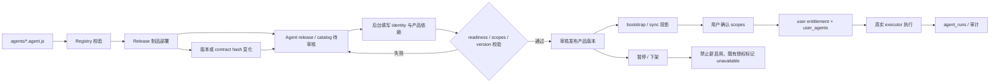

# 妙讯运营后台标准化改造设计

## 目标

把当前“单页工具面板”改造成围绕妙讯真实业务运营的后台系统，提供独立模块、大屏监控、用户与权限管理、Agent 与产品上架、任务运营、使用监控、审计和服务配置能力。后台只展示和修改后端真实数据，不创建演示数据，不把移动端页面状态当作后台配置。

## 核心约束

- `agent_catalog` 是 Agent 展示身份的唯一来源。名称、描述、头像标识、形状、颜色、上架状态及其版本由目录合同提供。
- Agent 的代码注册事实、运营目录审核状态和面向用户的产品发布状态分开存储，任何一个状态都不能隐式替代另一个状态。
- 移动端妙页、讯页、聊天详情、我页、动态和任务卡统一消费同一份 Agent identity；禁止静态头像、旧字段或页面专用 fallback。
- 缺少目录 identity 是数据合同错误，接口返回明确错误并记录审计；客户端和后台不得用旧身份继续渲染。
- 目录上架只控制可发现性和产品投影，不创建执行器、不绕过用户授权、不改变 Agent 权限。
- 产品目录与 Agent 注册表分离。产品绑定已部署 Agent、权限要求、版本、平台和展示身份；上架前必须通过依赖和配置就绪检查。
- 所有管理变更必须经过后端权限校验、幂等保护和审计记录；前端隐藏按钮不能代替后端授权。
- 统计只能使用真实数据库记录。未知成本、缺少 token 或没有记录时保持未知/空态，不用零值或示例数据填充。
- 不保留旧后台页面作为兼容入口；模块切换、API 响应和字段迁移完成后删除旧单页渲染路径。

## Agent 生命周期与发布合同

一个 Agent 从代码实现到 App 可用必须经过以下明确链路：



1. **代码注册**：开发者新增 `agents/<key>.agent.js`，文件名必须与 `key` 一致。registry 校验 key、版本、标准 identity、权限声明、workspace capability 和可执行方法。CI 只接受校验通过的 Agent；代码注册本身不代表已上架。
2. **制品部署**：后端发布制品包含该 Agent 的代码和 registry。部署后的同步任务把 registry 快照写入 `agent_registry`/`agent_catalog`，新 Agent 初始为待审核；不再使用运行时硬编码 key 列表决定默认上架。
3. **目录审核**：后台 Agent 中心读取代码版本、权限、contract hash、配置就绪度和目录 identity。管理员必须填写完整 `AgentIdentity`，确认展示名、描述、头像标识、形状、颜色、权限和支持能力；缺项、版本不匹配或 provider 未配置时不能提交审核。
4. **产品绑定**：后台产品中心创建产品版本，绑定一个或多个已注册 Agent、所需 scopes、支持平台和产品入口。产品提交审核时校验依赖 Agent 已通过目录审核且 executor/readiness 正常；产品上架是独立状态，不等于单个 Agent 自动上架。
5. **发布投影**：审核通过后，后台事务将 Agent 目录和产品版本置为 `published`，写入状态历史与审计。`bootstrap/sync` 只投影已发布且 identity 完整的产品和 Agent，并返回目录 revision/version；未上架或过期内容不进入推荐目录。
6. **用户启用**：App 在“我”页或产品入口展示已发布产品。用户确认产品所需 scopes 后，后端事务写入产品 entitlement 和对应 `user_agents`，创建 Agent 会话/欢迎消息；产品发布不能绕过用户授权，后台代授权也必须走同一权限和审计合同。
7. **执行与追踪**：执行前后端同时校验 entitlement、Agent enabled、granted scopes、registry version/contract hash 和产品版本。执行记录写入 `agent_runs`、任务事件和审计，运行时只能调用代码 registry 中的真实 executor。
8. **下架与升级**：下架/暂停禁止新用户发现和启用，保留已有 entitlement、会话和历史记录，并向 App 返回明确 `unavailable` 原因。代码版本、权限或 identity contract 改变时生成新 release，旧版本进入审核或迁移；既有授权在 scopes/hash 不匹配时必须重新同意，不能静默兼容旧合同。

发布状态至少包括：代码 `registered/removed`，目录 `draft/review/published/unpublished/archived`，产品版本 `draft/review/published/paused/retired`，用户 entitlement `enabled/disabled/unavailable/reconsent_required`。每次状态转换保存操作者、来源版本、时间、原因和 request ID。

当前实现中必须删除的旧路径包括：`currentCatalogueKeys` 运行时硬编码、RN `identity` 可选类型、组件按 `owned.identity || registered.identity` 的回退、`AgentGlyphAvatar` 的 `category/fallbackGlyph`、讯页静态头像映射，以及代码 Agent 删除后把 key 当作名称继续显示。这些情况统一显示数据合同错误或不可用状态，不渲染旧头像。

### 当前实现的实际链路与改造边界

当前代码已经具备一条可运行但不完整的链路：

```text
agents/<key>.agent.js
  -> agents/registry.js 动态加载与声明校验
  -> listRegisteredAgentsWithCatalogue()
  -> agent_catalog（展示字段 + published）
  -> /api/app/bootstrap 或 /api/app/sync
  -> App “我”页 PATCH /api/me/agents/:agentId
  -> user_agents + chat_threads
  -> assertAgentAvailable / assertCurrentAgentAccess
  -> registry executor + agent_runs
```

后台现在能编辑目录身份和 `published`，但缺少 release 快照、产品依赖、审核状态、配置就绪门禁和版本/contract hash 校验。因此“代码文件存在”目前仍可能被误解成“可以直接上架”，需要改成代码注册、目录审核和产品发布三层状态。

头像不一致的具体原因是移动端 `identity` 仍是可选值：部分页面用 `owned.identity`，部分页面用 `registered.identity` 兜底，`AgentGlyphAvatar` 还会按 Agent key/category 使用旧 glyph，讯页另有静态人物头像表。改造后所有页面必须接收同一个完整 `AgentIdentity`；如果目录投影缺失或过期，页面显示合同错误/不可用状态，禁止继续使用旧头像、Agent key 或 category 生成替代视觉。若产品需要讯页人物头像，它必须作为目录 identity 的标准 presentation/asset 字段由后台发布，不能由客户端按 key 私自映射。

## 信息架构

后台使用固定左侧导航、顶部环境与管理员信息区、主内容区和可复用详情抽屉。导航按权限生成，未授权模块不显示；直接访问无权限模块时由后端返回 403，并由前端显示明确拒绝状态。

### 总览大屏

显示当前时间窗口的用户、活跃、会话、消息、Agent 调用、任务队列、成功率、延迟、token、成本、媒体和内容指标。图表支持 7/30/90 天窗口和手动刷新；每个指标标注数据时间、来源和空态。大屏不触发模型调用。

### 用户与权限

用户列表支持搜索、状态、角色、最近活动和分页；详情展示资料、登录会话、授权 Agent、任务、审计摘要。管理员角色和权限拆分为 `users`、`permissions`、`agents`、`products`、`tasks`、`monitoring`、`audit`、`system` 资源的读写能力。保留后端自我降权和管理员保护规则。

### Agent 中心

分为注册能力、目录身份、上架状态、配置就绪度和授权概览。编辑只提交完整标准化 identity；局部更新使用后端 schema 合并并返回完整 identity。每个页面使用同一 `AgentIdentity` 组件和数据类型，无法解析 identity 时显示合同错误。

### 产品中心

产品由产品 key、展示名、描述、图标/身份、版本、支持平台、依赖 Agent、所需权限、审核状态和上架状态组成。草稿、审核中、已上架、已下架状态由后端状态机控制；上架事务同时校验 Agent 存在、目录 identity 完整、执行器配置就绪和权限声明完整。下架不撤销已有用户授权，但禁止新发现和新增授权。

### 任务中心

聚合 `ai_tasks`、Agent workspace 和 Agent run，支持按用户、产品、Agent、状态和时间筛选，展示排队、执行、成功、失败、中断和重试原因。后台只能对合同允许的任务执行重试、取消或查看，所有操作写入审计；不能把任务状态改写成成功。

### 使用监控

从 `agent_runs`、任务和事件表生成按 Agent、产品、用户、时间窗口的运行次数、成功率、失败率、延迟、token、成本和队列积压。查询接口返回聚合时间范围和数据新鲜度。不存在记录时返回空数组和空态，未知成本保持 `null`。

### 内容与运营

第一阶段提供动态、相册、文件和审核状态的真实检索与只读详情，沿用现有内容权限。下架、删除和审核动作另设明确权限和确认流程，不复制一套后台内容数据库。

### 审计与系统配置

审计页面支持按操作者、目标、模块、动作、结果和时间筛选，显示请求 ID、失败原因和脱敏 payload。系统配置只展示脱敏的模型、媒体、地理服务、版本和健康状态；供应商连通测试必须明确确认并计入审计。

## 数据与接口

- 后端新增 Agent release/审核、产品目录、产品状态变更、产品依赖校验、任务聚合和总览时间序列接口。
- 现有账号、权限、Agent 目录、使用监控、审计和服务状态接口迁移到模块化资源命名，并在一次切换中删除旧兼容路由。
- 所有写接口使用 Zod schema、资源级权限、幂等键和事务；响应统一为 `{ data, meta }`，错误统一包含稳定 `code` 和用户可读 message。
- 数据库新增 Agent registry/release 快照、产品目录、产品依赖、用户 entitlement、版本/状态历史和必要的聚合索引；迁移必须可重复检查并保留审计来源。
- `AgentIdentity` 在共享合同中定义必填字段：`key`、`displayName`、`description`、`mark`、`shape`、`colors`、`published`、`source`、`updatedAt`。服务端拒绝不完整身份，客户端不做旧字段映射。
- `AgentRelease` 必须携带 `agentKey`、`version`、`contractHash`、声明 scopes、readiness、目录状态和发布时间；`ProductVersion` 必须携带依赖 Agent 及其 scopes、平台和状态。

## 前端结构

- 保留 Vite 和当前静态部署方式。
- 将单一 `admin.js` 拆为 app shell、路由、权限上下文、API client、通用数据表、指标卡、图表、详情抽屉和各模块页面。
- 每个模块拥有独立加载、错误、空态和刷新状态；模块之间不共享隐式 DOM 状态。
- 统一使用标准 identity 组件渲染 Agent，目录接口返回错误时停止该卡片渲染并显示合同错误。
- 移除旧的“隐藏区块单页”渲染和旧字段兼容分支；部署产物只包含新入口。

## 安全与错误处理

- 后端权限是最终边界；前端权限只决定导航和操作可见性。
- 管理操作默认幂等，重复提交返回同一结果或稳定冲突码。
- API、数据库、统计或目录不完整时显示明确错误，保留失败上下文和 request ID。
- 生产环境不在后台显示密钥、原始 prompt、用户隐私正文或未脱敏供应商响应。
- 所有上架、权限、账号状态、任务控制和配置测试都写入审计记录。

## 验证标准

- 后端单测覆盖权限、产品状态机、目录 identity 完整性、任务聚合空态/未知值、幂等和审计。
- PostgreSQL 集成测试覆盖迁移、索引、产品上架事务和真实聚合查询。
- Admin 测试覆盖每个模块的加载、权限隐藏、403、错误态、空态、筛选、刷新和关键写操作。
- 移动端定向测试确认妙页、讯页、聊天详情、我页、动态和任务卡使用同一 identity，缺失 identity 不走 fallback；测试覆盖代码注册→后台审核→bootstrap/sync→用户启用→执行→下架/重授权完整链路。
- 运行 `./scripts/check-repository.sh`、Admin 构建和固定 iPhone 17 模拟器预览；线上部署与 TestFlight 另行授权。

## 分阶段交付

1. 后台 shell、权限上下文、模块路由和总览大屏。
2. 用户与权限模块，统一管理操作和审计。
3. Agent 中心与共享 identity，清理移动端旧头像路径。
4. 产品目录、依赖校验和上架状态机。
5. 任务中心、使用监控和真实聚合接口。
6. 内容运营只读模块、系统配置、文档和全链路验证。

